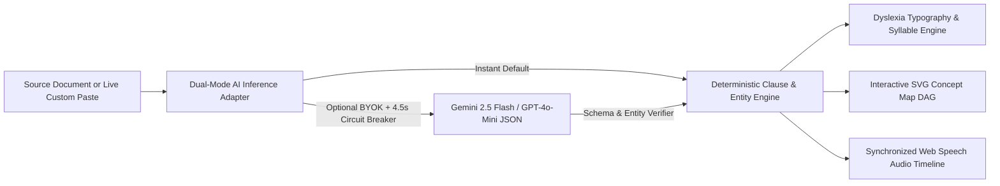

# LexiLens Studio — System Architecture

## 1. Architectural Diagram

## 2. Core Pure-Math Modules (`src/lib/`)

| Module | File | Responsibility |
| :--- | :--- | :--- |
| **Dyslexia Typography & Syllable Engine** | `src/lib/dyslexia/dyslexia-typography-engine.ts` | Vowel-cluster + domain lexicon syllable splitter, Bionic bold fixation anchors, WCAG 2.1 luminance contrast ratio math, and Flesch-Kincaid grade scoring. |
| **Clause Simplifier & Entity Verifier** | `src/lib/simplifier/clause-simplifier-engine.ts` | Multi-domain clause simplification (STEM Biology, Clinical Cardiology, Legal Lease, Quantum Physics + live custom text), numeric/dosage preservation checks, and phonetic analogy cards. |
| **Concept Graph DAG Engine** | `src/lib/concept/concept-graph-engine.ts` | 3-layer SVG Directed Acyclic Graph layout (`880x380`), zero-overlap bounding box verification, and connected subgraph filtering. |
| **Synchronized Audio Explainer** | `src/lib/audio/audio-explainer-engine.ts` | Syllable- and punctuation-weighted word cue schedule (`0.75x`–`1.25x`) and real-time elapsed-millisecond word index lookup. |
| **Dual-Mode AI Adapter** | `src/lib/ai/ai-inference-adapter.ts` | Instant zero-setup deterministic inference plus optional Gemini/OpenAI BYOK mode with `AbortController` timeout and schema hydration fallback. |
